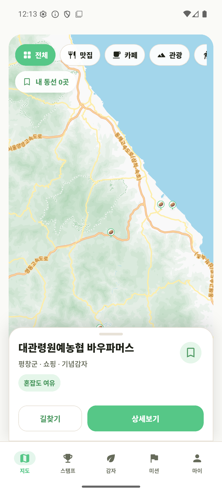
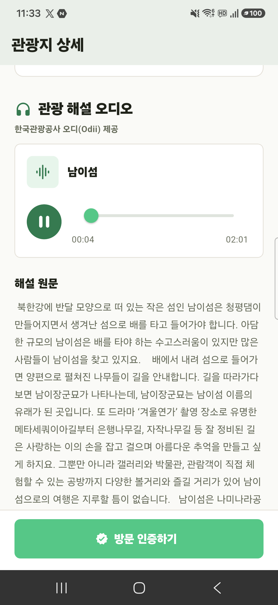
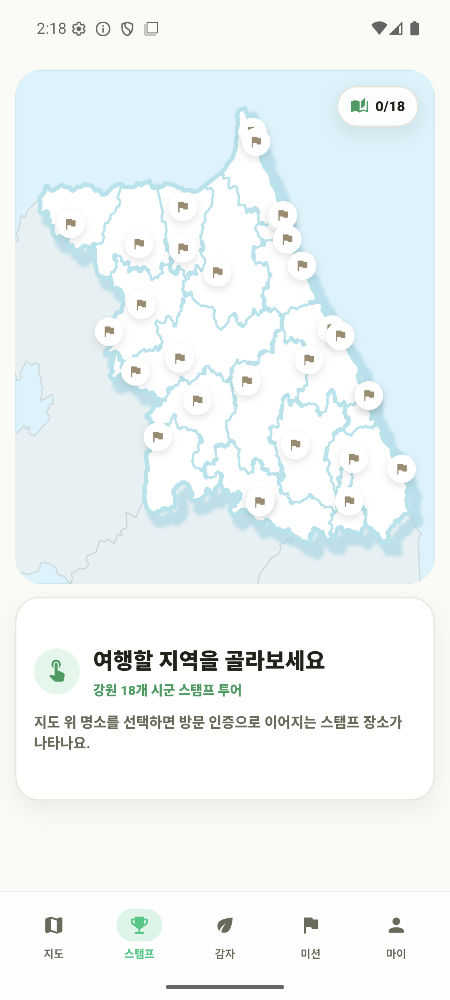
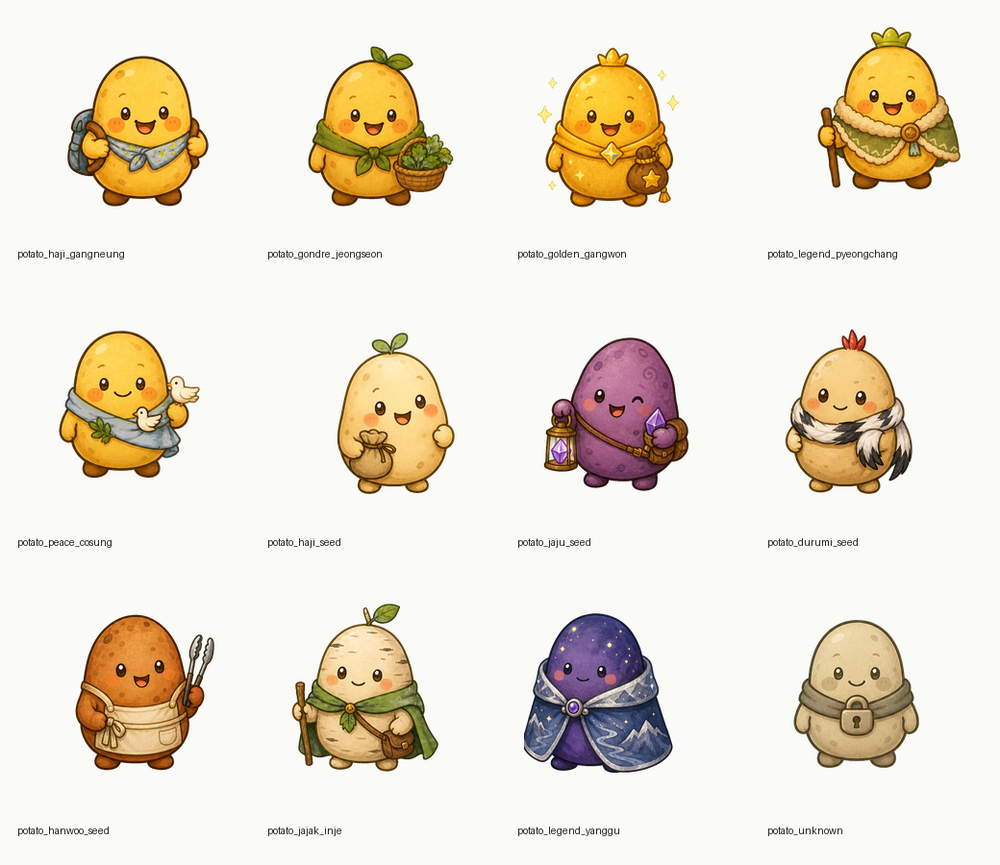
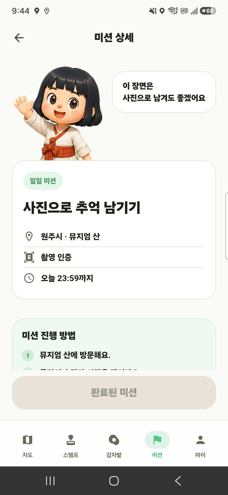
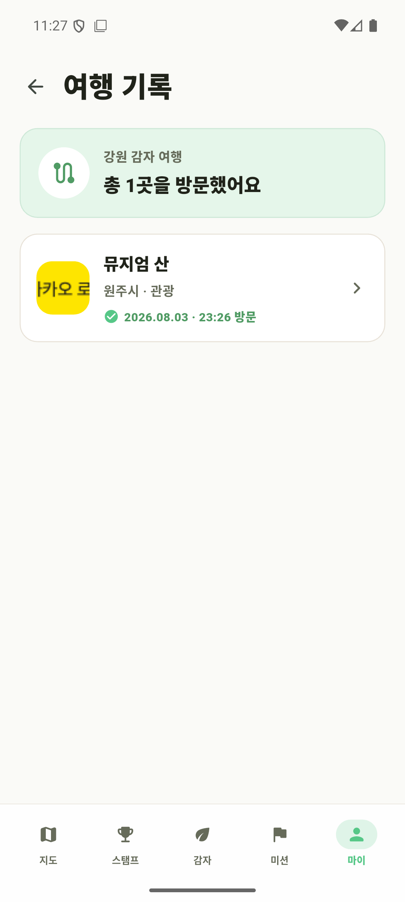
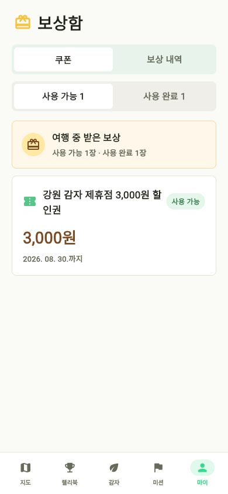

# 🥔 감자무봤나

### 감자를 따라 발견하는 강원의 숨은 매력

강원특별자치도 18개 시·군의 관광지를 탐색하고, 방문 스탬프와 지역 감자 캐릭터를 모으는 위치 기반 여행 서비스

  
  
  
  
  

[서비스 소개](#-서비스-소개) · [주요 화면](#-주요-화면) · [기술 스택](#-기술-스택)

---

## 🌱 서비스 소개

**감자무봤나**는 관광 정보와 수집형 게임 경험을 결합한 강원 여행 패스포트입니다.

사용자는 카카오맵에서 주변 관광지를 발견하고, 현장 방문을 인증해 디지털 스탬프를 획득합니다. 여행 과정에서 지역별 감자 캐릭터를 수집·성장시키고, 점순이 미션과 쿠폰 보상을 통해 다음 여행으로 자연스럽게 이어집니다.

| 🗺️ 발견 | 🏆 성취 | 🥔 수집 |
| :---: | :---: | :---: |
| 관광지·맛집·카페·체험 장소를 지도에서 탐색 | GPS 방문 인증과 29개 관광지 패스포트 완성 | 걸음과 미션으로 지역 감자 캐릭터 성장 |

> **서비스 범위**: 강원특별자치도 18개 시·군 · 스탬프 관광지 29곳 · 저장소 앱 버전 `1.0.0+1`

---

## 📱 주요 화면

### 1. 지도로 발견하고, 해설로 여행해요

관광지·맛집·카페·체험 장소를 한눈에 찾고, 길찾기와 관광 해설 오디오로 여행을 이어갑니다.

<table>
  <tr>
    <td align="center" width="50%">
       
      <b>감자 지도</b> 내 주변 장소 탐색과 여행 동선 저장
    </td>
    <td align="center" width="50%">
       
      <b>관광지 상세</b> 관광 정보와 한국관광공사 Odii 해설 재생
    </td>
  </tr>
</table>

### 2. 29개 관광지를 하나의 패스포트로 모아요

관광지 반경 안에서 방문을 인증하면 장소별 디지털 스탬프가 쌓이고, 강원 18개 시·군의 여행 진행도를 확인할 수 있습니다.

<table>
  <tr>
    <td align="center" width="50%">
       
      <b>스탬프 랠리북</b> 29개 관광지의 방문 목표를 지도에서 확인
    </td>
    <td align="center" width="50%">
       
      <b>관광지 패스포트</b> 장소마다 다른 스탬프를 하나씩 수집
    </td>
  </tr>
</table>

### 3. 걷고 도전하며 나만의 감자를 키워요

걸음 수로 대표 감자를 성장시키고, 점순이가 안내하는 위치·사진·걸음·퀴즈·QR 미션에 도전합니다.

<table>
  <tr>
    <td align="center" width="50%">
       
      <b>감자 도감</b> 여행하며 만나는 지역별 감자 캐릭터
    </td>
    <td align="center" width="50%">
       
      <b>점순이 미션</b> 오늘의 여행을 만드는 경험형 미션
    </td>
  </tr>
</table>

### 4. 여행의 순간과 보상을 한곳에 남겨요

방문과 미션에서 남긴 사진은 여행 기록으로 모이고, 획득한 쿠폰과 보상은 보상함에서 관리합니다.

<table>
  <tr>
    <td align="center" width="50%">
       
      <b>여행 기록</b> 방문 장소와 인증 사진을 날짜별로 보관
    </td>
    <td align="center" width="50%">
       
      <b>보상함</b> 스탬프와 미션으로 받은 여행 혜택 관리
    </td>
  </tr>
</table>

<b>활용 데이터와 외부 서비스</b>

- 한국관광공사 관광정보·오디오 가이드·관광객 집중도·연관 관광지 API
- Kakao Login, Kakao Maps, Kakao Local API
- Firebase Cloud Messaging
- Google Places 기반 관광지 상세정보 보강

---

## 🛠 기술 스택

---

**관광지는 보고 · 스탬프는 찍고 · 감자는 모으고**

